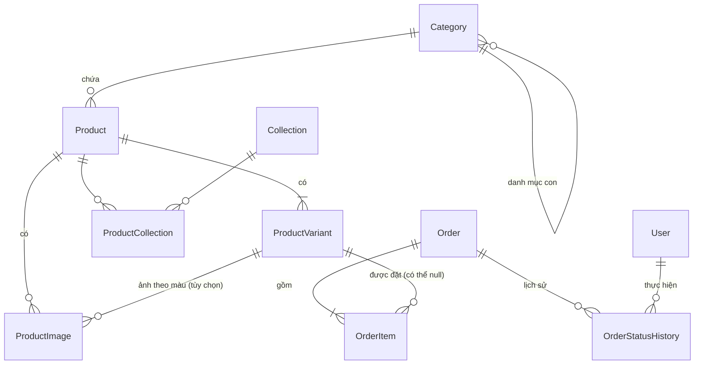
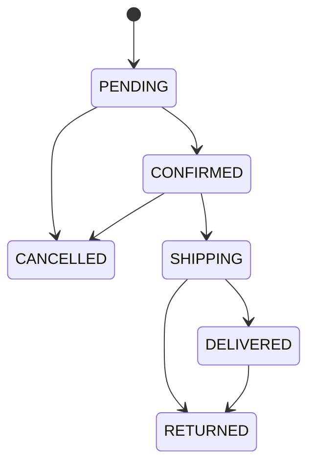

# 02 — DATABASE: Thiết kế cơ sở dữ liệu

> Dựa trên `00-MASTER-PLAN.md` v0.2 và `01-TECH-STANDARDS.md` v1.0 · Phiên bản: v1.2 · 2026-10-05
>
> PostgreSQL (Neon) + Prisma. Tiền là số nguyên VND. Thời gian lưu UTC. Phạm vi chi tiết: **P0**; bảng P1 được thiết kế sẵn ở mục 6 nhưng chưa tạo.

---

## 1. Tổng quan

### 1.1 Danh sách bảng P0

| Bảng | Mục đích |
|---|---|
| `User` | Tài khoản quản trị (hiện chỉ 1 người) |
| `Session`, `Account`, `Verification` | Bảng của Better Auth: phiên đăng nhập, mật khẩu đã băm, mã xác minh |
| `Category` | Danh mục sản phẩm (cành lẻ, bình hoa, giỏ hoa…) |
| `Collection` | Bộ sưu tập theo dịp (sinh nhật, khai trương, 20/10…) |
| `Product` | Thông tin chung của sản phẩm |
| `ProductVariant` | Biến thể bán được: màu × kích thước, có giá và tồn kho riêng |
| `ProductImage` | Ảnh sản phẩm (Cloudinary) |
| `ProductCollection` | Nối sản phẩm ↔ bộ sưu tập (nhiều–nhiều) |
| `Order` | Đơn hàng |
| `OrderItem` | Dòng sản phẩm trong đơn, chụp lại giá lúc đặt |
| `OrderStatusHistory` | Lịch sử đổi trạng thái đơn |
| `RateLimitHit` | Bộ đếm giới hạn tần suất (chống spam, khóa đăng nhập) |

### 1.2 Sơ đồ quan hệ



### 1.3 Quy ước chung cho mọi bảng
- Khóa chính `id`: chuỗi `cuid()`. Không lộ số thứ tự ra ngoài.
- Có `createdAt` (mặc định now) và `updatedAt` (tự cập nhật).
- Tiền: `Int`, đơn vị đồng. Ví dụ 350.000đ lưu là `350000`.
- Slug: chữ thường, không dấu, nối bằng `-`, **duy nhất**.
- Ảnh: chỉ lưu `publicId` của Cloudinary.

---

## 2. Enum

| Enum | Giá trị | Ý nghĩa |
|---|---|---|
| `UserRole` | `ADMIN` | Mở rộng thêm `STAFF` sau này |
| `ProductStatus` | `DRAFT` · `ACTIVE` · `ARCHIVED` | Nháp (ẩn) · đang bán · ngừng bán (ẩn, giữ dữ liệu) |
| `OrderStatus` | `PENDING` · `CONFIRMED` · `SHIPPING` · `DELIVERED` · `CANCELLED` · `RETURNED` | Chờ xác nhận · đã xác nhận/đang chuẩn bị · đang giao · đã giao · đã hủy · hoàn hàng |
| `PaymentMethod` | `COD` · `BANK_TRANSFER` | |
| `PaymentStatus` | `UNPAID` · `PAID` · `REFUNDED` | |
| `ShippingZone` | `HANOI_INNER` · `NORTH` · `CENTRAL_SOUTH` | Dùng để tính phí ship |

### Luồng trạng thái đơn hợp lệ



Mọi chuyển trạng thái khác bị từ chối với lỗi `INVALID_STATUS_TRANSITION`. Khi đơn chuyển sang `CANCELLED` hoặc `RETURNED`, hệ thống **cộng lại tồn kho**.

---

## 3. Chi tiết từng bảng

Cột “Bắt buộc”: ✔ = NOT NULL · – = có thể để trống.

### 3.1 `User`
| Trường | Kiểu | Bắt buộc | Ghi chú |
|---|---|---|---|
| id | String | ✔ | cuid |
| email | String | ✔ | **unique**, chữ thường |
| name | String | ✔ | |
| emailVerified | Boolean | ✔ | Trường bắt buộc của Better Auth |
| image | String | – | Trường của Better Auth, không dùng |
| role | UserRole | ✔ | mặc định `ADMIN` — trường bổ sung |
| mustChangePassword | Boolean | ✔ | mặc định true; bắt đổi mật khẩu ban đầu — trường bổ sung |
| lastLoginAt | DateTime | – | trường bổ sung |

> Bảng `User`, `Session`, `Account`, `Verification` theo **schema chuẩn của Better Auth**: sinh bằng CLI của Better Auth rồi thêm các trường bổ sung ở trên (khai báo là `additionalFields` trong `lib/auth.ts`). Mật khẩu đã băm nằm trong `Account.password`, không nằm trong `User`. Đổi mật khẩu dùng tùy chọn thu hồi các phiên khác.
| createdAt, updatedAt | DateTime | ✔ | |

### 3.2 `Category`
| Trường | Kiểu | Bắt buộc | Ghi chú |
|---|---|---|---|
| id | String | ✔ | |
| name | String | ✔ | “Bình hoa cắm sẵn” |
| slug | String | ✔ | **unique**, “binh-hoa-cam-san” |
| description | String | – | Hiện ở đầu trang danh mục, hỗ trợ SEO |
| imagePublicId | String | – | Ảnh đại diện danh mục |
| parentId | String | – | FK → Category; cho phép 1 cấp con |
| sortOrder | Int | ✔ | mặc định 0, sắp xếp menu |
| isActive | Boolean | ✔ | mặc định true |
| seoTitle, seoDescription | String | – | Để trống thì dùng name/description |
| createdAt, updatedAt | DateTime | ✔ | |

### 3.3 `Collection`
| Trường | Kiểu | Bắt buộc | Ghi chú |
|---|---|---|---|
| id | String | ✔ | |
| name | String | ✔ | “Quà 20/10” |
| slug | String | ✔ | **unique** |
| description | String | – | |
| imagePublicId | String | – | Ảnh banner bộ sưu tập |
| isActive | Boolean | ✔ | mặc định true |
| showOnHome | Boolean | ✔ | mặc định false; hiện trên trang chủ |
| sortOrder | Int | ✔ | mặc định 0 |
| createdAt, updatedAt | DateTime | ✔ | |

### 3.4 `Product`
| Trường | Kiểu | Bắt buộc | Ghi chú |
|---|---|---|---|
| id | String | ✔ | |
| name | String | ✔ | “Bình hoa mẫu đơn Lamora” |
| slug | String | ✔ | **unique** |
| categoryId | String | ✔ | FK → Category |
| shortDescription | String | – | 1–2 câu, hiện cạnh giá |
| description | String | – | Mô tả dài (Markdown) |
| material | String | – | “Lụa cao cấp, cành thép bọc nhựa” |
| careInstructions | String | – | Hướng dẫn vệ sinh, bảo quản |
| status | ProductStatus | ✔ | mặc định `DRAFT` |
| isFeatured | Boolean | ✔ | mặc định false; hiện “sản phẩm nổi bật” |
| priceFrom | Int | ✔ | **Giá thấp nhất** trong các biến thể đang bán. Tự cập nhật bởi service khi sửa biến thể. Dùng để lọc/sắp xếp nhanh |
| searchText | String | ✔ | Tên + danh mục + màu, **không dấu, chữ thường**. Tự sinh, phục vụ tìm kiếm tiếng Việt |
| seoTitle, seoDescription | String | – | |
| publishedAt | DateTime | – | Lần đầu chuyển sang ACTIVE; dùng sắp xếp “mới nhất” |
| archivedAt | DateTime | – | Xóa mềm |
| createdAt, updatedAt | DateTime | ✔ | |

### 3.5 `ProductVariant`
| Trường | Kiểu | Bắt buộc | Ghi chú |
|---|---|---|---|
| id | String | ✔ | |
| productId | String | ✔ | FK → Product, xóa product thì xóa variant |
| sku | String | ✔ | **unique**, ví dụ `LMR-BH001-HONG-M`. Tự sinh, sửa được |
| colorName | String | ✔ | “Hồng phấn”. Chuỗi rỗng `""` nếu sản phẩm không có màu |
| colorHex | String | – | `#E8B4B8`, vẽ ô chọn màu |
| size | String | ✔ | “Nhỏ (30cm)”. Chuỗi rỗng `""` nếu không có cỡ |
| price | Int | ✔ | Giá bán |
| compareAtPrice | Int | – | Giá gốc để gạch ngang; phải lớn hơn price |
| stockQuantity | Int | ✔ | mặc định 0, không được âm |
| isActive | Boolean | ✔ | mặc định true |
| sortOrder | Int | ✔ | mặc định 0 |
| createdAt, updatedAt | DateTime | ✔ | |

**Ràng buộc:** unique `(productId, colorName, size)`. Dùng chuỗi rỗng thay cho `NULL` vì PostgreSQL coi các giá trị `NULL` là khác nhau, khiến ràng buộc unique không chặn được biến thể trùng. Sản phẩm không có biến thể thì vẫn có **đúng 1 variant** với `colorName = ""` và `size = ""`, để luồng giỏ hàng và đơn hàng luôn giống nhau. Giao diện ẩn ô chọn màu/cỡ khi giá trị rỗng.

### 3.6 `ProductImage`
| Trường | Kiểu | Bắt buộc | Ghi chú |
|---|---|---|---|
| id | String | ✔ | |
| productId | String | ✔ | FK → Product, cascade |
| variantId | String | – | FK → ProductVariant, set null; dùng để đổi ảnh khi khách chọn màu |
| publicId | String | ✔ | Cloudinary |
| alt | String | ✔ | Mô tả ảnh tiếng Việt |
| width, height | Int | ✔ | Tránh nhảy layout |
| sortOrder | Int | ✔ | Ảnh `sortOrder` nhỏ nhất là ảnh đại diện |
| createdAt | DateTime | ✔ | |

### 3.7 `ProductCollection`
| Trường | Kiểu | Ghi chú |
|---|---|---|
| productId | String | FK, cascade |
| collectionId | String | FK, cascade |
| sortOrder | Int | Thứ tự trong bộ sưu tập |

Khóa chính ghép `(productId, collectionId)`.

### 3.8 `Order`

**Nhóm định danh và trạng thái**
| Trường | Kiểu | Bắt buộc | Ghi chú |
|---|---|---|---|
| id | String | ✔ | |
| code | String | ✔ | **unique**, `LMR-YYMMDD-XXXX` (XXXX = 4 ký tự chữ+số in hoa, bỏ ký tự dễ nhầm O/0/I/1) |
| status | OrderStatus | ✔ | mặc định `PENDING` |
| paymentMethod | PaymentMethod | ✔ | |
| paymentStatus | PaymentStatus | ✔ | mặc định `UNPAID` |

**Nhóm người đặt**
| Trường | Kiểu | Bắt buộc | Ghi chú |
|---|---|---|---|
| customerName | String | ✔ | |
| customerPhone | String | ✔ | Chuẩn hóa dạng `0xxxxxxxxx` (10 số) |
| customerEmail | String | – | |

**Nhóm người nhận và địa chỉ giao**
| Trường | Kiểu | Bắt buộc | Ghi chú |
|---|---|---|---|
| recipientName | String | ✔ | Mặc định bằng người đặt; khác nếu là quà tặng |
| recipientPhone | String | ✔ | |
| provinceCode, provinceName | String | ✔ | Tỉnh/thành |
| wardCode, wardName | String | ✔ | Phường/xã |
| addressLine | String | ✔ | Số nhà, đường, thôn… |
| shippingZone | ShippingZone | ✔ | Tính từ provinceCode lúc đặt |

> Địa chỉ dùng mô hình **2 cấp tỉnh → phường/xã** theo sắp xếp đơn vị hành chính từ 01/07/2025. Danh sách tỉnh/xã lấy từ bộ dữ liệu JSON đặt trong `src/config/`, không lưu thành bảng. Cần kiểm tra lại bộ dữ liệu mới nhất khi code.

**Nhóm quà tặng và yêu cầu**
| Trường | Kiểu | Bắt buộc | Ghi chú |
|---|---|---|---|
| isGift | Boolean | ✔ | mặc định false |
| giftMessage | String | – | Lời nhắn in thiệp, tối đa 300 ký tự |
| giftWrap | Boolean | ✔ | mặc định false |
| preferredDeliveryDate | DateTime | – | Ngày khách muốn nhận (chỉ phần ngày) |
| customerNote | String | – | Ghi chú của khách |

**Nhóm tiền** (tất cả tính ở server)
| Trường | Kiểu | Bắt buộc | Ghi chú |
|---|---|---|---|
| subtotal | Int | ✔ | Tổng các dòng sản phẩm |
| shippingFee | Int | ✔ | |
| giftWrapFee | Int | ✔ | mặc định 0 |
| discountAmount | Int | ✔ | mặc định 0 (dành cho voucher P1) |
| total | Int | ✔ | `subtotal + shippingFee + giftWrapFee − discountAmount` |

**Nhóm xử lý của shop**
| Trường | Kiểu | Bắt buộc | Ghi chú |
|---|---|---|---|
| adminNote | String | – | Ghi chú nội bộ, khách không thấy |
| carrier | String | – | Tên đơn vị vận chuyển |
| trackingCode | String | – | Mã vận đơn |
| cancelReason | String | – | |
| paidAt, confirmedAt, shippedAt, deliveredAt, cancelledAt | DateTime | – | Ghi khi chuyển trạng thái tương ứng |

**Nhóm chống spam**
| Trường | Kiểu | Bắt buộc | Ghi chú |
|---|---|---|---|
| ipHash | String | – | Băm IP, không lưu IP gốc |
| createdAt, updatedAt | DateTime | ✔ | |

### 3.9 `OrderItem`
| Trường | Kiểu | Bắt buộc | Ghi chú |
|---|---|---|---|
| id | String | ✔ | |
| orderId | String | ✔ | FK → Order, cascade |
| productId | String | – | FK → Product, **set null** khi xóa |
| variantId | String | – | FK → ProductVariant, **set null** khi xóa |
| productName | String | ✔ | Chụp lại lúc đặt |
| variantLabel | String | – | “Hồng phấn / Nhỏ (30cm)” |
| sku | String | ✔ | |
| imagePublicId | String | – | Ảnh lúc đặt |
| unitPrice | Int | ✔ | Giá lúc đặt |
| quantity | Int | ✔ | 1–99 |
| lineTotal | Int | ✔ | `unitPrice × quantity` |
| cardMessage | String | – | Lời nhắn thiệp riêng của dòng này (tối đa 300 ký tự) |
| giftWrap | Boolean | ✔ | Dòng này có gói quà (mặc định false). Phí = 20.000₫ × số dòng có gói; `Order.giftWrapFee` là tổng, `Order.giftMessage` chỉ còn ở đơn cũ |

### 3.10 `OrderStatusHistory`
| Trường | Kiểu | Bắt buộc | Ghi chú |
|---|---|---|---|
| id | String | ✔ | |
| orderId | String | ✔ | FK, cascade |
| fromStatus | OrderStatus | – | Null với bản ghi tạo đơn |
| toStatus | OrderStatus | ✔ | |
| note | String | – | |
| changedById | String | – | FK → User; null nếu khách/hệ thống |
| createdAt | DateTime | ✔ | |

### 3.11 `RateLimitHit`
| Trường | Kiểu | Bắt buộc | Ghi chú |
|---|---|---|---|
| id | String | ✔ | |
| key | String | ✔ | Ví dụ `order:<ipHash>`, `login:<email>` |
| createdAt | DateTime | ✔ | |

Đếm số bản ghi cùng `key` trong khoảng thời gian; dọn bản ghi cũ hơn 1 ngày mỗi ngày (`09` mục 7).

---

## 4. Index

| Bảng | Index | Phục vụ |
|---|---|---|
| Product | `slug` unique | Trang chi tiết |
| Product | `(status, categoryId)` | Danh sách theo danh mục |
| Product | `(status, isFeatured)` | Trang chủ |
| Product | `(status, priceFrom)` | Lọc/sắp xếp giá |
| Product | `(status, publishedAt)` | Sắp xếp mới nhất |
| Product | GIN trigram trên `searchText` | Tìm kiếm (cần extension `pg_trgm`, tạo bằng migration SQL) |
| ProductVariant | `sku` unique; `productId`; `colorName` | Lọc màu |
| Category / Collection | `slug` unique | |
| Order | `code` unique | Tra cứu |
| Order | `customerPhone` | Tra cứu, tìm khách cũ |
| Order | `(status, createdAt)` | Danh sách đơn trong admin |
| Order | `(paymentStatus, createdAt)` | Lọc đơn chưa thanh toán |
| OrderItem | `orderId` | |
| RateLimitHit | `(key, createdAt)` | Đếm nhanh theo khóa |

---

## 5. Prisma schema (bản nháp)

> Phần `generator`/`datasource` dưới đây viết theo kiểu cũ. Từ **Prisma 7**, URL kết nối (`DATABASE_URL`, `DIRECT_URL`) khai báo trong `prisma.config.ts` và generator mới yêu cầu `output`. Khi khởi tạo: giữ nguyên phần `model` và `enum`, viết phần cấu hình theo tài liệu chính thức của phiên bản đang cài.

```prisma
generator client {
  provider = "prisma-client-js"
}

datasource db {
  provider  = "postgresql"
  url       = env("DATABASE_URL")
  directUrl = env("DIRECT_URL")
}

enum UserRole { ADMIN }
enum ProductStatus { DRAFT ACTIVE ARCHIVED }
enum OrderStatus { PENDING CONFIRMED SHIPPING DELIVERED CANCELLED RETURNED }
enum PaymentMethod { COD BANK_TRANSFER }
enum PaymentStatus { UNPAID PAID REFUNDED }
enum ShippingZone { HANOI_INNER NORTH CENTRAL_SOUTH }

// User, Session, Account, Verification: sinh bằng CLI của Better Auth,
// sau đó thêm các trường bổ sung dưới đây vào model User.
model User {
  id                 String               @id
  name               String
  email              String               @unique
  emailVerified      Boolean              @default(false)
  image              String?
  role               UserRole             @default(ADMIN)
  mustChangePassword Boolean              @default(true)
  lastLoginAt        DateTime?
  sessions           Session[]
  accounts           Account[]
  statusChanges      OrderStatusHistory[]
  createdAt          DateTime             @default(now())
  updatedAt          DateTime             @updatedAt
}

// model Session { ... }       ← theo Better Auth
// model Account { ... }       ← theo Better Auth (chứa password đã băm)
// model Verification { ... }  ← theo Better Auth

model Category {
  id             String     @id @default(cuid())
  name           String
  slug           String     @unique
  description    String?
  imagePublicId  String?
  parentId       String?
  parent         Category?  @relation("CategoryTree", fields: [parentId], references: [id], onDelete: Restrict)
  children       Category[] @relation("CategoryTree")
  sortOrder      Int        @default(0)
  isActive       Boolean    @default(true)
  seoTitle       String?
  seoDescription String?
  products       Product[]
  createdAt      DateTime   @default(now())
  updatedAt      DateTime   @updatedAt
}

model Collection {
  id            String              @id @default(cuid())
  name          String
  slug          String              @unique
  description   String?
  imagePublicId String?
  isActive      Boolean             @default(true)
  showOnHome    Boolean             @default(false)
  sortOrder     Int                 @default(0)
  products      ProductCollection[]
  createdAt     DateTime            @default(now())
  updatedAt     DateTime            @updatedAt
}

model Product {
  id               String              @id @default(cuid())
  name             String
  slug             String              @unique
  categoryId       String
  category         Category            @relation(fields: [categoryId], references: [id], onDelete: Restrict)
  shortDescription String?
  description      String?
  material         String?
  careInstructions String?
  status           ProductStatus       @default(DRAFT)
  isFeatured       Boolean             @default(false)
  priceFrom        Int                 @default(0)
  searchText       String              @default("")
  seoTitle         String?
  seoDescription   String?
  publishedAt      DateTime?
  archivedAt       DateTime?
  variants         ProductVariant[]
  images           ProductImage[]
  collections      ProductCollection[]
  orderItems       OrderItem[]
  createdAt        DateTime            @default(now())
  updatedAt        DateTime            @updatedAt

  @@index([status, categoryId])
  @@index([status, isFeatured])
  @@index([status, priceFrom])
  @@index([status, publishedAt])
}

model ProductVariant {
  id             String         @id @default(cuid())
  productId      String
  product        Product        @relation(fields: [productId], references: [id], onDelete: Cascade)
  sku            String         @unique
  colorName      String         @default("")
  colorHex       String?
  size           String         @default("")
  price          Int
  compareAtPrice Int?
  stockQuantity  Int            @default(0)
  isActive       Boolean        @default(true)
  sortOrder      Int            @default(0)
  images         ProductImage[]
  orderItems     OrderItem[]
  createdAt      DateTime       @default(now())
  updatedAt      DateTime       @updatedAt

  @@unique([productId, colorName, size])
  @@index([productId])
  @@index([colorName])
}

model ProductImage {
  id        String          @id @default(cuid())
  productId String
  product   Product         @relation(fields: [productId], references: [id], onDelete: Cascade)
  variantId String?
  variant   ProductVariant? @relation(fields: [variantId], references: [id], onDelete: SetNull)
  publicId  String
  alt       String
  width     Int
  height    Int
  sortOrder Int             @default(0)
  createdAt DateTime        @default(now())

  @@index([productId, sortOrder])
}

model ProductCollection {
  productId    String
  collectionId String
  sortOrder    Int        @default(0)
  product      Product    @relation(fields: [productId], references: [id], onDelete: Cascade)
  collection   Collection @relation(fields: [collectionId], references: [id], onDelete: Cascade)

  @@id([productId, collectionId])
}

model Order {
  id                    String               @id @default(cuid())
  code                  String               @unique
  status                OrderStatus          @default(PENDING)
  paymentMethod         PaymentMethod
  paymentStatus         PaymentStatus        @default(UNPAID)

  customerName          String
  customerPhone         String
  customerEmail         String?

  recipientName         String
  recipientPhone        String
  provinceCode          String
  provinceName          String
  wardCode              String
  wardName              String
  addressLine           String
  shippingZone          ShippingZone

  isGift                Boolean              @default(false)
  giftMessage           String?
  giftWrap              Boolean              @default(false)
  preferredDeliveryDate DateTime?            @db.Date
  customerNote          String?

  subtotal              Int
  shippingFee           Int
  giftWrapFee           Int                  @default(0)
  discountAmount        Int                  @default(0)
  total                 Int

  adminNote             String?
  carrier               String?
  trackingCode          String?
  cancelReason          String?
  paidAt                DateTime?
  confirmedAt           DateTime?
  shippedAt             DateTime?
  deliveredAt           DateTime?
  cancelledAt           DateTime?

  ipHash                String?
  items                 OrderItem[]
  statusHistory         OrderStatusHistory[]
  createdAt             DateTime             @default(now())
  updatedAt             DateTime             @updatedAt

  @@index([customerPhone])
  @@index([status, createdAt])
  @@index([paymentStatus, createdAt])
}

model OrderItem {
  id            String          @id @default(cuid())
  orderId       String
  order         Order           @relation(fields: [orderId], references: [id], onDelete: Cascade)
  productId     String?
  product       Product?        @relation(fields: [productId], references: [id], onDelete: SetNull)
  variantId     String?
  variant       ProductVariant? @relation(fields: [variantId], references: [id], onDelete: SetNull)
  productName   String
  variantLabel  String?
  sku           String
  imagePublicId String?
  unitPrice     Int
  quantity      Int
  lineTotal     Int
  cardMessage   String?
  giftWrap      Boolean         @default(false)

  @@index([orderId])
}

model OrderStatusHistory {
  id          String       @id @default(cuid())
  orderId     String
  order       Order        @relation(fields: [orderId], references: [id], onDelete: Cascade)
  fromStatus  OrderStatus?
  toStatus    OrderStatus
  note        String?
  changedById String?
  changedBy   User?        @relation(fields: [changedById], references: [id], onDelete: SetNull)
  createdAt   DateTime     @default(now())

  @@index([orderId, createdAt])
}

model RateLimitHit {
  id        String   @id @default(cuid())
  key       String
  createdAt DateTime @default(now())

  @@index([key, createdAt])
}
```

**Migration SQL bổ sung** (tạo thủ công sau migration đầu tiên):
```sql
CREATE EXTENSION IF NOT EXISTS pg_trgm;
CREATE INDEX product_search_trgm ON "Product" USING GIN ("searchText" gin_trgm_ops);
ALTER TABLE "ProductVariant" ADD CONSTRAINT stock_non_negative CHECK ("stockQuantity" >= 0);
ALTER TABLE "OrderItem" ADD CONSTRAINT quantity_range CHECK ("quantity" BETWEEN 1 AND 99);
```

---

## 6. Bảng dự kiến cho P1 (chưa tạo)

| Bảng | Trường chính | Ghi chú |
|---|---|---|
| `Voucher` | code (unique), type (`PERCENT`/`FIXED`), value, minOrderAmount, maxDiscount, usageLimit, usedCount, startsAt, endsAt, isActive | Thêm `voucherId` vào `Order` |
| `Banner` | title, subtitle, imagePublicId, mobileImagePublicId, linkUrl, sortOrder, isActive, startsAt, endsAt | Banner trang chủ |
| `StockMovement` | variantId, change (+/−), reason (`ORDER`/`CANCEL`/`MANUAL`/`IMPORT`), orderId, note, createdById | Lịch sử nhập/xuất kho |
| `ShopSetting` | key (unique), value (JSON) | Chuyển bảng phí ship, thông tin liên hệ từ file config sang DB để sửa trong admin |

Đăng nhập admin dùng Better Auth với phiên lưu trong bảng `Session` (mục 3.1).

---

## 7. Dữ liệu mẫu (seed)

`prisma/seed.ts` tạo:
- 1 tài khoản admin từ `ADMIN_EMAIL` và `ADMIN_INITIAL_PASSWORD`.
- 5 danh mục theo master plan.
- 4 bộ sưu tập: Sinh nhật, Khai trương, Trang trí nhà, Quà 20/10.
- 12 sản phẩm mẫu, mỗi sản phẩm 1–4 biến thể, 2–3 ảnh mẫu.
- 3 đơn hàng mẫu ở các trạng thái khác nhau.

Seed chỉ chạy ở môi trường local và preview, **không chạy** trên production (trừ bước tạo admin).

---

## 8. Cần xác nhận

1. Phí gói quà: tôi đặt mặc định **20.000đ**, nằm trong `src/config/shipping.ts`. Bạn muốn mức nào?
2. Danh mục có cần cấp con không (ví dụ “Cành hoa lẻ” → “Hoa hồng”, “Mẫu đơn”)? Schema đã hỗ trợ 1 cấp con; nếu không cần thì giao diện chỉ hiện 1 cấp.
3. Có bán sản phẩm khi hết hàng (đặt trước) không? Mặc định: **không**, hết hàng thì không cho đặt.

---

## Nhật ký thay đổi

| Phiên bản | Ngày | Thay đổi |
|---|---|---|
| v1.2 | 2026-10-05 | Bảng người dùng theo Better Auth (bỏ `passwordHash`, `passwordChangedAt`); `colorName`/`size` dùng chuỗi rỗng thay `NULL` để ràng buộc unique hoạt động |
| v1.1 | 2026-10-05 | Thêm bảng `RateLimitHit`, cột `User.passwordChangedAt`, `User.mustChangePassword` (theo `08`) |
| v1.0 | 2026-10-05 | Bản đầu tiên |
