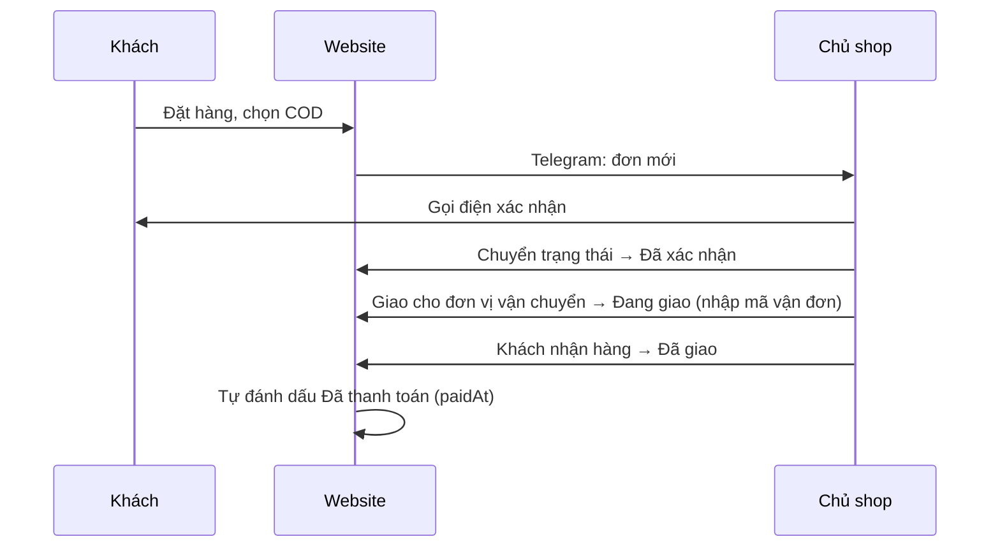
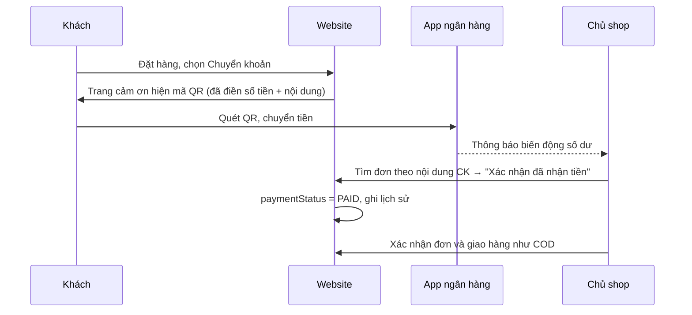

# 07 — PAYMENT & SHIPPING: Thanh toán, vận chuyển, thông báo

> Dựa trên `00-MASTER-PLAN.md` v0.2, `01-TECH-STANDARDS.md` v1.0, `02-DATABASE.md` v1.1, `04-SERVER-LAYER.md` v1.1 · Phiên bản: v1.0 · 2026-10-05
>
> Phạm vi P0: **COD** và **chuyển khoản VietQR xác nhận thủ công**; phí ship tính theo vùng; báo đơn mới qua **Telegram**.

---

## 1. Thanh toán khi nhận hàng (COD)

### Luồng


### Quy tắc
- Đơn COD tạo ra với `paymentStatus = UNPAID`.
- Khi chuyển sang `DELIVERED`, service tự đặt `paymentStatus = PAID`, `paidAt = now` (xem `04` mục 8.2 #6).
- Tiền thu hộ trên phiếu giao = `Order.total`.
- Không có giới hạn giá trị đơn COD ở P0. Có thể thêm `COD_MAX_AMOUNT` trong `config/shipping.ts` nếu gặp đơn ảo giá trị lớn.

---

## 2. Chuyển khoản qua VietQR

### 2.1 Luồng


### 2.2 Sinh mã QR
Dùng dịch vụ ảnh **VietQR Quick Link** (miễn phí, không cần đăng ký, không cần backend riêng):

```
https://img.vietqr.io/image/<BANK_BIN>-<ACCOUNT_NO>-<TEMPLATE>.png
    ?amount=<TỔNG_TIỀN>
    &addInfo=<NỘI_DUNG_CK>
    &accountName=<TÊN_CHỦ_TK>
```

| Tham số | Giá trị | Nguồn |
|---|---|---|
| `BANK_BIN` | Mã BIN ngân hàng 6 số | `env.BANK_BIN` |
| `ACCOUNT_NO` | Số tài khoản | `env.BANK_ACCOUNT_NO` |
| `TEMPLATE` | `compact2` (có logo ngân hàng, số tiền, nội dung) | hằng số |
| `amount` | `Order.total` | DB |
| `addInfo` | Nội dung chuyển khoản (mục 2.3) | sinh từ mã đơn |
| `accountName` | Tên chủ tài khoản, encode URL | `env.BANK_ACCOUNT_NAME` |

- Hàm thuần `buildVietQrUrl({ amount, transferContent })` đặt trong `features/payment/service.ts`, có unit test.
- Dùng `next/image` với `unoptimized` (ảnh QR không được nén làm mờ). Kích thước hiển thị 240×284px.
- Dự phòng: nếu ảnh QR không tải được, vẫn hiện đầy đủ thông tin chữ để khách chuyển thủ công.

### 2.3 Nội dung chuyển khoản

Nội dung chuyển khoản trên VietQR **không hỗ trợ ký tự đặc biệt** và tối đa 50 ký tự. Vì vậy:

| Mục | Giá trị |
|---|---|
| Mã đơn hiển thị | `LMR-261005-K7QF` |
| Nội dung chuyển khoản | `LMR261005K7QF` (bỏ dấu gạch) |
| Hàm | `toTransferContent(code) = code.replaceAll('-', '')` |

Trang admin cho phép tìm đơn bằng **cả hai dạng** (ô tìm kiếm tự bỏ dấu gạch khi so khớp).

### 2.4 Quy tắc
- Chỉ hiện QR khi `paymentMethod = BANK_TRANSFER` và `paymentStatus = UNPAID`.
- Ghi chú dưới QR: “Vui lòng giữ nguyên nội dung chuyển khoản để chúng tôi xác nhận nhanh.”
- Đơn chuyển khoản **vẫn bắt đầu ở `PENDING`**. Chủ shop thường xác nhận thanh toán trước rồi mới xác nhận đơn, nhưng hệ thống không bắt buộc thứ tự.
- Không tự hủy đơn chưa thanh toán ở P0 (xem `04` mục 15).
- Hoàn tiền (đơn đã trả bị hủy): chủ shop chuyển trả thủ công, rồi bấm “Đã hoàn tiền” → `paymentStatus = REFUNDED`. Thêm vào `updateOrderStatus` như một tùy chọn khi hủy đơn đã `PAID`.

### 2.5 Mở rộng sau (P2)
- **Tự xác nhận thanh toán**: dùng dịch vụ đọc biến động số dư gửi webhook (ví dụ Casso, SePay). Webhook vào `/api/webhooks/bank`, khớp nội dung CK với `toTransferContent(code)` và số tiền, rồi gọi `markOrderPaid`. Cần kiểm tra điều khoản và chi phí của dịch vụ khi làm.
- **Cổng thanh toán** VNPay / MoMo khi có giấy phép kinh doanh.

---

## 3. Vận chuyển

### 3.1 Dữ liệu địa chỉ
- Mô hình **2 cấp: tỉnh/thành → phường/xã**, theo sắp xếp đơn vị hành chính áp dụng từ 01/07/2025 (34 tỉnh, thành phố).
- Lưu thành file JSON tĩnh: `src/config/address/provinces.json` và `src/config/address/wards/<provinceCode>.json` (tách theo tỉnh để trang thanh toán chỉ tải phần cần).
- Mỗi bản ghi: `{ code, name, nameAscii }` — `nameAscii` dùng cho tìm kiếm không dấu.
- Nguồn dữ liệu: bộ danh mục đơn vị hành chính chính thức mới nhất. **Kiểm tra lại số lượng và tên khi code**, ghi nguồn và ngày lấy dữ liệu vào đầu file `src/config/address/README.md`.

### 3.2 Vùng giao hàng

`src/config/shipping.ts` chứa bảng vùng theo tên tỉnh/thành (34 đơn vị). Map theo `provinceCode` khi đã có dữ liệu thật.

| Vùng | Tỉnh/thành |
|---|---|
| `HANOI_INNER` | Hà Nội |
| `NORTH` | Hải Phòng, Quảng Ninh, Bắc Ninh, Hưng Yên, Ninh Bình, Phú Thọ, Thái Nguyên, Tuyên Quang, Lào Cai, Cao Bằng, Lạng Sơn, Lai Châu, Điện Biên, Sơn La |
| `CENTRAL_SOUTH` | Tất cả tỉnh/thành còn lại (từ Thanh Hóa trở vào) |

> Đối chiếu danh sách với dữ liệu hành chính thật khi code. Tỉnh không có trong bảng → mặc định `CENTRAL_SOUTH` và ghi log cảnh báo.

### 3.3 Bảng phí

```ts
// src/config/shipping.ts
export const SHIPPING_FEES = {
  HANOI_INNER: 25_000,
  NORTH: 35_000,
  CENTRAL_SOUTH: 40_000,
} as const;

export const FREE_SHIPPING_THRESHOLD = 800_000;
export const GIFT_WRAP_FEE = 20_000;

export const ESTIMATED_DELIVERY_DAYS = {
  HANOI_INNER: '1–2 ngày',
  NORTH: '2–3 ngày',
  CENTRAL_SOUTH: '3–5 ngày',
} as const;
```

### 3.4 Công thức

```
zone        = getZoneByProvince(provinceCode)
shippingFee = subtotal >= FREE_SHIPPING_THRESHOLD ? 0 : SHIPPING_FEES[zone]
giftWrapFee = giftWrap ? GIFT_WRAP_FEE : 0
total       = subtotal + shippingFee + giftWrapFee − discountAmount
```
- `subtotal` dùng để xét miễn phí ship là tổng tiền hàng **trước** giảm giá.
- Unit test bắt buộc: mỗi vùng; ngay dưới, bằng và trên mốc miễn phí; có/không gói quà; tỉnh không xác định.

### 3.5 Giao hàng thực tế (vận hành, ngoài code)
- P0: chủ shop tự tạo đơn trên app của đơn vị vận chuyển, rồi nhập **tên đơn vị + mã vận đơn** khi chuyển đơn sang “Đang giao”.
- Danh sách đơn vị gợi ý trong ô chọn (`config/shipping.ts → CARRIERS`): Giao Hàng Nhanh, Giao Hàng Tiết Kiệm, Viettel Post, J&T Express, Tự giao, Khác.
- Trang tra cứu đơn hiển thị mã vận đơn để khách tự tra trên trang của đơn vị vận chuyển.
- P2: kết nối API đơn vị vận chuyển để tạo vận đơn và lấy phí tự động.

---

## 4. Thông báo Telegram

### 4.1 Cài đặt (chủ shop làm một lần)
1. Mở Telegram, tìm **@BotFather**, gửi `/newbot`, đặt tên (ví dụ “Lamora Đơn hàng”) → nhận **token**.
2. Nhắn một tin bất kỳ cho bot vừa tạo.
3. Lấy **chat ID**: mở `https://api.telegram.org/bot<TOKEN>/getUpdates`, tìm `"chat":{"id": ...}`.
4. Lưu vào biến môi trường `TELEGRAM_BOT_TOKEN`, `TELEGRAM_CHAT_ID` (local và Netlify).

### 4.2 Gửi tin
- Gọi `POST https://api.telegram.org/bot<TOKEN>/sendMessage` với `chat_id`, `text`, `parse_mode: "HTML"`.
- Hàm `notifyNewOrder(order)` trong `features/notification/service.ts`. Timeout 5 giây; lỗi chỉ ghi log, **không** ảnh hưởng đơn hàng.
- Escape ký tự `< > &` trong tên khách và ghi chú trước khi gửi.

### 4.3 Mẫu tin nhắn
```
🌸 ĐƠN MỚI · LMR-261005-K7QF
Khách: Nguyễn Thu Hà · 0912345678
Giao: Phường Hoàn Kiếm, Hà Nội
Ngày muốn nhận: 08/10/2026
🎁 Quà tặng · Có gói quà

• Mẫu đơn hồng phấn (Hồng / Nhỏ) ×1 — 650.000₫
• Cành hồng lụa trắng ×3 — 270.000₫

Tổng: 940.000₫ · Chuyển khoản (chưa thanh toán)
Mở đơn: https://<tên-miền>/admin/don-hang/<id>
```

### 4.4 Mở rộng
- P1: tin nhắc lúc 8:00 sáng mỗi ngày nếu còn đơn `PENDING` (cần tác vụ định kỳ, xem `09` mục 7).
- P1: email xác nhận đơn cho khách khi có tên miền riêng (dịch vụ gửi email có gói miễn phí, chọn khi làm).

---

## 5. Cập nhật các file khác

| File | Thay đổi |
|---|---|
| `04` mục 9 | `transferContent` = mã đơn bỏ dấu gạch (`toTransferContent`) |
| `04` mục 8.2 #6 | Hủy đơn đã `PAID` có tùy chọn đánh dấu `REFUNDED` |
| `01` mục 4 | Thêm thư mục `src/config/address/` |

---

## 6. Cần xác nhận

1. Bạn dùng ngân hàng nào và tên chủ tài khoản là gì? (Chỉ cần khi cài đặt biến môi trường, **không** gửi số tài khoản vào tài liệu.)
2. Bảng phí ship và thời gian giao dự kiến ở mục 3.3 có khớp với đơn vị vận chuyển bạn hay dùng không?

---

## Nhật ký thay đổi

| Phiên bản | Ngày | Thay đổi |
|---|---|---|
| v1.0 | 2026-10-05 | Bản đầu tiên |
