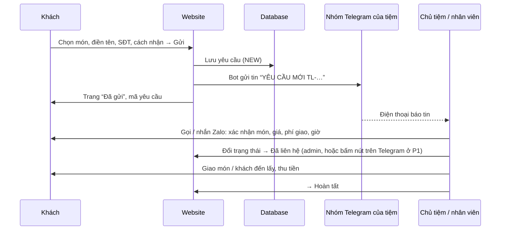

# 07 — TELEGRAM & ĐẶT MÓN: Luồng bán hàng qua Telegram

> Dựa trên `00-MASTER-PLAN.md` v1.0, `01-TECH-STANDARDS.md` v2.0, `02-DATABASE.md` v2.0, `04-SERVER-LAYER.md` v2.0 · Phiên bản: v2.0 · 2026-10-07
>
> Thay cho `07-PAYMENT-SHIPPING.md` của Lamora (bản cũ ở `_ban-cu-lamora-flower/`). Web **không** thu tiền, **không** tính phí ship. Mọi việc chốt đơn, báo giá cuối, thanh toán diễn ra giữa tiệm và khách qua điện thoại / Zalo / Telegram.

---

## 1. Luồng đặt món



### 1.1 Quy tắc vận hành (ghi vào trang Giới thiệu/Đặt món cho khách hiểu)
- Yêu cầu **chưa phải đơn đã chốt** cho tới khi tiệm gọi lại.
- Giá trên web là **giá tham khảo**; phí giao báo khi gọi.
- Thanh toán: tiền mặt khi nhận, hoặc chuyển khoản theo thông tin tiệm gửi qua tin nhắn. Web **không** hiện số tài khoản.
- Tiệm cam kết gọi lại `CALLBACK_PROMISE` trong giờ mở cửa; ngoài giờ gọi lại khi mở cửa.
- Không liên lạc được sau 2 lần gọi → hủy với lý do “Không liên lạc được”.

### 1.2 Luồng liên hệ
Form liên hệ → lưu `ContactMessage` → bot gửi tin “TIN NHẮN MỚI” → tiệm gọi/nhắn lại → đánh dấu “Đã xử lý” trong admin.

### 1.3 Khách muốn chat trực tiếp
Nút **Telegram** trên web mở `SITE.telegramUrl` (`https://t.me/<username>`) — cuộc chat với **tài khoản Telegram của tiệm** (người thật), tách biệt với bot. Nút **Zalo** mở `https://zalo.me/<SĐT>`. Đây là kênh song song, không qua database.

---

## 2. Vì sao lưu database trước rồi mới gửi Telegram
- Telegram có thể lỗi (token sai, mạng chậm, bot bị xóa khỏi nhóm). Nếu chỉ gửi Telegram, yêu cầu sẽ **mất**.
- Thứ tự bắt buộc: **transaction lưu yêu cầu → gửi Telegram → ghi `telegramSentAt`**.
- Lỗi gửi chỉ ghi log; khách vẫn thấy “đã gửi”.
- Yêu cầu chưa gửi được: hiện ⚠ trong admin (M2, M3), và được gửi lại tự động (mục 5).

---

## 3. Cài đặt bot (chủ tiệm làm một lần)

1. Mở Telegram, tìm **@BotFather** → `/newbot` → đặt tên “Thanh Long – Đặt món”, username kết thúc bằng `bot` → nhận **token**. Giữ bí mật token.
2. Tạo **nhóm** Telegram “Thanh Long – Đặt món”, thêm bot và những người cần nhận tin (chủ tiệm, nhân viên quầy).
3. Trong nhóm, gửi lệnh `/start@<username_bot>`.
4. Mở `https://api.telegram.org/bot<TOKEN>/getUpdates`, tìm `"chat":{"id":-100…}` của nhóm → đó là **chat ID** (số âm với nhóm). Nếu không thấy, gửi thêm một tin nhắc tới bot rồi tải lại.
5. Lưu `TELEGRAM_BOT_TOKEN`, `TELEGRAM_CHAT_ID`, `TELEGRAM_ENABLED=true` vào biến môi trường (local và Netlify Production).
6. Môi trường preview: `TELEGRAM_ENABLED=false`, hoặc dùng một nhóm thử nghiệm riêng.
7. Trong nhóm, bật thông báo (không tắt tiếng) trên điện thoại của người trực quầy.

**Kiểm tra**: gửi một yêu cầu thử trên web → nhóm nhận tin trong vài giây.

---

## 4. Mẫu tin nhắn

Gửi bằng `POST https://api.telegram.org/bot<TOKEN>/sendMessage` với `chat_id`, `text`, `parse_mode: "HTML"`, `link_preview_options: { is_disabled: true }`. Mọi nội dung khách nhập phải escape `& < >` (`lib/telegram.ts → escapeHtml`). Tin dài tối đa 4096 ký tự: ghi chú khách cắt ở 500 ký tự (đã giới hạn ở form).

### 4.1 Yêu cầu đặt món mới
```
🥖 YÊU CẦU ĐẶT MÓN · TL-261007-K7QF
👤 Nguyễn Văn An · 0912345678
💬 Zalo: https://zalo.me/0912345678
🛵 Giao tận nơi: 12 Nguyễn Trãi, P. Bến Thành
⏰ Nhận lúc: 07:30 hôm nay (08/10)

• Bánh mì thịt nguội (Đặc biệt) ×2 — 70.000₫
• Bánh mì trứng ốp la ×1 — 20.000₫
• Cà phê sữa đá ×3 — 60.000₫

Tạm tính: 150.000₫ (chưa gồm phí giao)
📝 Ghi chú: Không hành, 1 ổ ít cay

Mở trong admin: https://<tên-miền>/admin/yeu-cau/<id>
```
- Lấy tại quầy: dòng `🏪 Lấy tại quầy`.
- Nhận sớm nhất: `⏰ Nhận lúc: sớm nhất`.
- Gửi ngoài giờ: thêm dòng đầu `🌙 Gửi ngoài giờ — gọi lại khi mở cửa`.
- Gửi lại (retry): thêm `(gửi lại)` sau mã.

### 4.2 Tin liên hệ mới
```
✉️ TIN NHẮN LIÊN HỆ
👤 Trần Thị Bình · 0987654321
💬 Zalo: https://zalo.me/0987654321

“Tiệm có nhận đặt 50 ổ cho công ty sáng thứ Hai không ạ?”

Mở trong admin: https://<tên-miền>/admin/lien-he
```

### 4.3 Cảnh báo hệ thống
- Đăng nhập admin: `🔐 Đăng nhập quản trị lúc 22:41 07/10/2026`.
- Health check lỗi 2 lần liên tiếp: `⚠️ Website không phản hồi lúc …` (`09` mục 7).

---

## 5. Gửi lại khi lỗi

| Cơ chế | Chi tiết |
|---|---|
| Tự động (1) | Mỗi lần có yêu cầu / tin liên hệ mới gửi Telegram thành công, service thử gửi luôn tối đa 3 bản ghi còn tồn (`telegramSentAt IS NULL`, tạo trong 24 giờ qua). Không tốn thêm tác vụ định kỳ |
| Tự động (2) | Workflow `monitor.yml` (gộp chung với health check, `09` mục 7) gọi `POST /api/cron/telegram-retry` **mỗi 30 phút** trong giờ mở cửa. Mỗi bản ghi thử tối đa 3 lần (đếm bằng `RateLimitHit` key `tg-retry:<id>`) |
| Thủ công | Nút “Gửi lại Telegram” ở M4, M5 |
| Báo động | Còn bản ghi chưa gửi > 60 phút → workflow báo lỗi, GitHub gửi email (vì chính Telegram có thể đang lỗi) |

> Vì sao không chạy dày hơn: repo private có khoảng 2.000 phút GitHub Actions miễn phí/tháng và mỗi lần chạy tính tối thiểu 1 phút. 30 phút/lần trong giờ mở cửa + mỗi giờ ban đêm ≈ 40 lần/ngày ≈ 1.200 phút/tháng, còn chỗ cho CI. Kiểm tra lại hạn mức khi đăng ký (`09` mục 2).

---

## 6. P1 — Bấm nút trên tin Telegram để đổi trạng thái

Mục tiêu: nhân viên xử lý ngay trong nhóm Telegram, không cần mở admin.

```
[ 📞 Đã gọi & chốt ]  [ ✅ Hoàn tất ]  [ ✖ Hủy ]
```

| Bước | Chi tiết |
|---|---|
| 1 | Tin 4.1 gửi kèm `reply_markup.inline_keyboard`; `callback_data` = `rq:<id>:<STATUS>` (≤ 64 byte) |
| 2 | Đăng ký webhook một lần: `setWebhook(url=https://<tên-miền>/api/telegram/webhook, secret_token=<TELEGRAM_WEBHOOK_SECRET>, allowed_updates=["callback_query"])` |
| 3 | Route kiểm tra header `X-Telegram-Bot-Api-Secret-Token` và `callback_query.message.chat.id = TELEGRAM_CHAT_ID`; sai → 401 |
| 4 | Gọi chung hàm đổi trạng thái của service (`source = TELEGRAM`, ghi tên người bấm vào `note`). Bước chuyển không hợp lệ → `answerCallbackQuery` báo lỗi |
| 5 | Sửa tin gốc (`editMessageText` dùng `telegramMessageId`): thêm dòng `— Đã chốt bởi Hùng lúc 07:12`, cập nhật bàn phím chỉ còn nút hợp lệ |
| 6 | “Hủy” trên Telegram ghi lý do mặc định “Hủy từ Telegram”; sửa lý do chi tiết trong admin |

Lưu ý: dùng webhook thì không dùng được `getUpdates` nữa; muốn lấy lại chat ID phải `deleteWebhook` trước.

---

## 7. Giới hạn và an toàn
- Telegram giới hạn khoảng 20 tin/phút vào một nhóm — dư sức với < 100 yêu cầu/ngày.
- Token bot chỉ nằm ở server. Lộ token → `/revoke` với @BotFather, cập nhật Netlify, deploy lại.
- Tin Telegram chứa tên + SĐT khách: chỉ thêm vào nhóm những người cần xử lý; người nghỉ việc phải bị xóa khỏi nhóm.
- Không gửi địa chỉ giao vào nhóm nếu khách chọn lấy tại quầy (không có địa chỉ).

---

## 8. Giao món (vận hành, ngoài code)
- Giao trong bán kính `DELIVERY_RADIUS_TEXT`; tiệm tự giao hoặc gọi xe công nghệ, báo phí khi gọi xác nhận.
- Đơn số lượng lớn (văn phòng, sự kiện): khuyến khích đặt trước ≥ 1 ngày; ghi chú trong yêu cầu hoặc nhắn trực tiếp.
- P2: kết nối đơn vị giao hàng / app giao đồ ăn nếu cần.

---

## 9. Cần xác nhận
1. Nhận tin vào **nhóm** (nhiều người) hay **chat cá nhân** của chủ tiệm? Mặc định: nhóm.
2. Username Telegram của tiệm cho nút “Chat Telegram” trên web (tài khoản người, không phải bot).
3. Cam kết gọi lại trong bao lâu? Mặc định hiển thị “trong ít phút”.

---

## Nhật ký thay đổi

| Phiên bản | Ngày | Thay đổi |
|---|---|---|
| v2.0 | 2026-10-07 | File mới cho Bánh Mì Thanh Long, thay `07-PAYMENT-SHIPPING.md`: luồng đặt món qua Telegram, mẫu tin, cài bot vào nhóm, gửi lại khi lỗi, nút bấm trên Telegram (P1). Bỏ COD, VietQR, phí ship |
