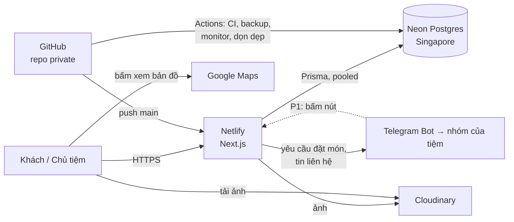
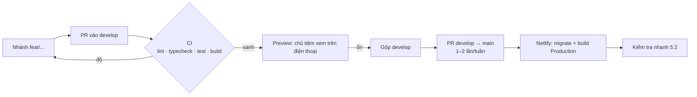

# 09 — DEPLOYMENT: Hạ tầng, triển khai, sao lưu, vận hành

> Dựa trên `00-MASTER-PLAN.md` v1.0, `01-TECH-STANDARDS.md` v2.0, `07-TELEGRAM-DAT-MON.md` v2.0, `08-SECURITY-SEO.md` v2.0 · Phiên bản: v2.0 · 2026-10-07
>
> Mục tiêu: chạy thật với chi phí **gần 0đ/tháng** (chỉ trả tiền tên miền), dễ vận hành bởi một người. Hạ tầng giữ như bản Lamora; khác biệt chính: không còn VietQR, thêm tác vụ gửi lại Telegram, dùng project Neon và Cloudinary **mới**.

---

## 1. Sơ đồ hạ tầng

---

## 2. Dịch vụ và gói miễn phí

| Dịch vụ | Gói | Giới hạn chính cần nhớ | Khi chạm giới hạn |
|---|---|---|---|
| **Netlify** | Free | **300 credits/tháng**; mỗi lần deploy production ~15 credits; băng thông ~20 credits/GB | Website **tạm dừng** đến tháng sau |
| **Neon** | Free | 1 GB lưu trữ; 100 CU-giờ compute/tháng; tự tắt sau 5 phút; khôi phục 6 giờ gần nhất | Compute tạm ngừng |
| **Cloudinary** | Free | 25 credits/tháng | Ảnh ngừng phục vụ |
| **GitHub** | Free (private) | Khoảng 2.000 phút Actions/tháng, mỗi lần chạy tính tối thiểu 1 phút | Actions dừng đến tháng sau |
| **Telegram Bot** | Miễn phí | ~20 tin/phút vào một nhóm | — |
| **Tên miền** | Trả phí theo năm | — | — |

> Giới hạn các dịch vụ thay đổi thường xuyên. **Kiểm tra lại khi đăng ký** và ghi vào mục 10.

### 2.1 Ngân sách credits Netlify (ước tính/tháng)

| Hạng mục | Ước tính | Credits |
|---|---|---|
| Deploy production | 8 lần | 120 |
| Băng thông HTML/JS/CSS (ảnh ở Cloudinary) | ~2 GB | 40 |
| Request + compute (trang tĩnh, chỉ form và admin chạy server) | | 60 |
| **Dự phòng** | | **80** |
| **Tổng** | | **300** |

**Quy tắc để không vượt credits** (giữ từ bản cũ)
1. Việc hằng ngày gộp vào `develop`; gộp `develop` → `main` 1–2 lần/tuần; tối đa **10 deploy production/tháng**.
2. Bỏ qua build khi chỉ sửa `docs/` hoặc `*.md` (lệnh `ignore` trong `netlify.toml`).
3. Ảnh luôn ở Cloudinary, không đặt ảnh lớn trong `public/`.
4. Trang khách cache tĩnh (`08` mục 15).
5. **Đổi giá / bật “Tạm hết” trong admin không cần deploy** — chỉ làm mới cache.
6. Theo dõi credits mỗi tuần trong tháng đầu.

### 2.2 Phương án dự phòng
- **A.** Nâng gói trả phí thấp nhất của Netlify.
- **B.** Chuyển sang Cloudflare Workers với adapter OpenNext (kiểm tra mức hỗ trợ Next.js khi chuyển).

### 2.3 Ngân sách phút GitHub Actions (ước tính/tháng)

| Workflow | Lịch | Phút |
|---|---|---|
| `ci.yml` | ~60 PR/push × ~5 phút | 300 |
| `monitor.yml` (health + gửi lại Telegram) | 30 phút/lần trong giờ mở cửa, 1 giờ/lần ban đêm ≈ 40 lần/ngày | 1.200 |
| `backup.yml` | 1 lần/ngày × ~2 phút | 60 |
| `cron.yml` (dọn dẹp) | 1 lần/ngày | 30 |
| **Tổng** | | **~1.600 / 2.000** |

Nếu sát hạn mức: giãn `monitor.yml` ban đêm thành 2 giờ/lần, hoặc chuyển repo sang public (không khuyến nghị).

---

## 3. Môi trường

| Môi trường | Code | Database | URL | Telegram |
|---|---|---|---|---|
| **Local** | máy chủ tiệm | Neon branch `dev` (hoặc Postgres máy) | `localhost:3000` | Tắt, hoặc nhóm thử |
| **Preview** | mỗi PR và `develop` | Neon branch `preview` | URL preview Netlify | Tắt (`TELEGRAM_ENABLED=false`) |
| **Production** | `main` | Neon branch `main` | tên miền chính | Nhóm thật của tiệm |

Biến môi trường trên Netlify đặt **theo ngữ cảnh** để preview không ghi vào DB thật và không gửi tin vào nhóm thật.

---

## 4. Thiết lập lần đầu

### 4.1 Tài khoản (tạo **mới** cho Bánh Mì Thanh Long, không dùng chung với Lamora)
- [ ] GitHub: repository **private** `banh-mi-thanh-long` (`12` bước 0).
- [ ] Neon: project `banh-mi-thanh-long`, region **Singapore**. Branch `dev`, `preview`.
- [ ] Cloudinary: thư mục `thanhlong/products`, `thanhlong/categories`, `thanhlong/site` (có thể dùng chung tài khoản Cloudinary cũ, khác thư mục).
- [ ] Telegram: bot + nhóm theo `07` mục 3.
- [ ] Netlify: site mới, chưa kết nối repo cho tới khi CI xanh.

### 4.2 Kết nối Netlify
- [ ] Import repo, nhánh production `main`.
- [ ] Lệnh build: `pnpm prisma migrate deploy && pnpm build` (Production và Preview, mỗi ngữ cảnh trỏ đúng branch Neon).
- [ ] Node theo `.nvmrc`.
- [ ] Biến môi trường theo `01` mục 14.
- [ ] Bỏ qua build khi chỉ sửa tài liệu.

### 4.3 Tên miền
- [ ] Mua `banhmithanhlong.vn` hoặc `.com` (kiểm tra còn trống).
- [ ] Trỏ DNS về Netlify; bật Force HTTPS; chọn một dạng chính (có/không `www`), dạng còn lại 301.
- [ ] Cập nhật `NEXT_PUBLIC_SITE_URL`, `SITE_URL` (GitHub), link “Trang web” trên Google Business Profile.
- [ ] P1: đăng ký lại webhook Telegram với tên miền mới (`07` mục 6).

---

## 5. Quy trình phát hành

### 5.1 Trước khi gộp `develop` vào `main`
- [ ] CI xanh; đã xem preview trên điện thoại.
- [ ] Migration tương thích ngược.
- [ ] Thay đổi chạm form đặt món / Telegram: chạy E2E.

### 5.2 Kiểm tra nhanh sau deploy production (5 phút)
- [ ] Trang chủ, thực đơn, một trang món mở được; giá đúng.
- [ ] Gửi một yêu cầu đặt món thử → nhóm Telegram nhận tin → hủy yêu cầu thử với lý do “Thử nghiệm”.
- [ ] Đăng nhập admin được.
- [ ] `/api/health` trả `ok`.

### 5.3 Quay lại bản trước
Netlify → Deploys → chọn bản trước → **Publish deploy**. Dữ liệu hỏng: khôi phục theo mục 6.3.

---

## 6. Sao lưu và khôi phục

### 6.1 Sao lưu tự động hằng ngày (giữ từ bản cũ)
- `backup.yml`, **02:00 giờ Việt Nam**: `pg_dump` (branch `main`, phiên bản khớp Neon) → nén → **mã hóa GPG** (`BACKUP_PASSPHRASE`) → artifact giữ **30 ngày**.
- Chủ nhật: chủ tiệm tải một bản về Google Drive.
- Lỗi → GitHub gửi email.

### 6.2 Ảnh
Giữ **ảnh gốc** của món trong máy / Google Drive. `publicId` có trong bản sao lưu DB.

### 6.3 Khôi phục
1. Sự cố trong 6 giờ: khôi phục theo thời điểm của Neon (tạo branch, kiểm tra, đổi sang).
2. Cũ hơn: tải artifact → giải mã → `pg_restore` vào branch mới → trỏ `DATABASE_URL`.
3. **Diễn tập khôi phục** một lần trước ra mắt, sau đó mỗi quý.

> Dữ liệu quan trọng nhất là **thực đơn**; yêu cầu đặt món đã có bản sao trong nhóm Telegram. Mất DB vẫn tiếp tục bán được bằng điện thoại/Zalo trong lúc khôi phục.

---

## 7. Tác vụ định kỳ

GitHub Actions `schedule` gọi route nội bộ với `Authorization: Bearer <CRON_SECRET>`. Lịch dùng giờ UTC (06:00 VN = 23:00 UTC hôm trước) và có thể trễ vài phút.

| Tác vụ | Lịch (giờ VN) | Cách làm | Ưu tiên |
|---|---|---|---|
| Sao lưu database | 02:00 hằng ngày | `backup.yml` | P0 |
| **Monitor**: kiểm tra `/api/health` + gọi `POST /api/cron/telegram-retry` | Mỗi 30 phút trong giờ mở cửa, mỗi giờ ban đêm | `monitor.yml`. Health lỗi 2 lần liên tiếp → gửi Telegram cảnh báo; còn bản ghi chưa gửi > 60 phút → job lỗi → email | P0 |
| Dọn `RateLimitHit` > 1 ngày, xóa `ipHash` > 90 ngày | 03:00 hằng ngày | `cron.yml` → `POST /api/cron/cleanup` | P0 |
| Ẩn thông tin cá nhân yêu cầu > 12 tháng | 03:00 hằng ngày | cùng `cleanup` | P1 |
| Bật lại món “Tạm hết” | 05:00 hằng ngày | `POST /api/cron/reset-availability` | P1, tùy chọn |

---

## 8. Giám sát và xử lý sự cố

| Theo dõi | Ở đâu | Tần suất |
|---|---|---|
| Credits Netlify | Netlify → Usage | Hằng tuần |
| Phút GitHub Actions | GitHub → Settings → Billing | Hằng tháng |
| Neon, Cloudinary | Bảng điều khiển | Hằng tháng |
| Lỗi server | Netlify → Logs (Functions) | Khi có báo lỗi |
| Yêu cầu chưa gửi Telegram | Admin M2 (thẻ cảnh báo) | Mỗi ngày |
| Tốc độ trang | PageSpeed Insights | Hằng tháng |
| Lượt xem, lượt bấm “Đặt món”/“Gọi” | Google Analytics (sự kiện) | Hằng tuần |
| Tìm kiếm, Maps | Search Console, Google Business Profile | Hằng tháng |

### 8.1 Sổ tay sự cố
| Hiện tượng | Kiểm tra | Xử lý |
|---|---|---|
| Không nhận tin Telegram | Admin M2 có thẻ “Chưa gửi được”? Token, chat ID; bot còn trong nhóm? | Sửa biến môi trường, thêm lại bot, bấm “Gửi lại” |
| Website báo tạm dừng | Credits Netlify | Nâng gói hoặc phương án 2.2; tạm thời nhận đơn qua điện thoại/Zalo |
| Trang tải chậm vài giây | Neon vừa thức dậy (chỉ admin/form) | Bình thường ở gói Free |
| Ảnh không hiện | Credits Cloudinary | Nâng gói / giảm biến đổi ảnh |
| Nhóm Telegram bị spam yêu cầu | Admin M3, log rate limit | Bật Turnstile (`08` mục 3); hạ giới hạn |
| Lộ token / khóa | — | Đổi ngay, cập nhật Netlify, deploy lại |

---

## 9. File cấu hình

| File | Nội dung |
|---|---|
| `netlify.toml` | Lệnh build theo ngữ cảnh, `ignore` cho thay đổi chỉ ở docs |
| `.github/workflows/ci.yml` | lint, typecheck, test, build, `pnpm audit` |
| `.github/workflows/e2e.yml` | Playwright, chạy thủ công hoặc nhãn `e2e` |
| `.github/workflows/backup.yml` | Mục 6.1 |
| `.github/workflows/monitor.yml` | Health + gửi lại Telegram (thay `health.yml` cũ) |
| `.github/workflows/cron.yml` | Dọn dẹp |
| `.github/dependabot.yml` | Hằng tháng, gộp nhóm, vào `develop` |
| `.nvmrc` | Node LTS |

**Biến bí mật GitHub Actions**: `PROD_DIRECT_URL`, `BACKUP_PASSPHRASE`, `CRON_SECRET`, `SITE_URL`, `TELEGRAM_BOT_TOKEN`, `TELEGRAM_CHAT_ID`.

---

## 10. Nhật ký kiểm tra gói dịch vụ

| Ngày | Dịch vụ | Giới hạn ghi nhận | Người kiểm tra |
|---|---|---|---|
| 2026-10-05 | Netlify Free | 300 credits/tháng; deploy production 15 credits | Lập kế hoạch (Lamora) |
| 2026-10-05 | Neon Free | 1 GB; 100 CU-giờ/tháng; tự tắt sau 5 phút | Lập kế hoạch (Lamora) |
| 2026-10-05 | Cloudinary Free | 25 credits/tháng | Lập kế hoạch (Lamora) |
| _(điền khi đăng ký)_ | GitHub Actions | phút miễn phí/tháng cho repo private | |

---

## 11. Cần xác nhận
1. Tên miền `.vn` hay `.com`?
2. Có Google Drive để lưu bản sao lưu hằng tuần?
3. Giờ mở cửa thật (để đặt lịch `monitor.yml` dày trong giờ bán).

---

## Nhật ký thay đổi

| Phiên bản | Ngày | Thay đổi |
|---|---|---|
| v2.0 | 2026-10-07 | Chuyển sang Bánh Mì Thanh Long: tài khoản/DB mới, bỏ VietQR, thêm `monitor.yml` (health + gửi lại Telegram), ngân sách phút GitHub Actions, môi trường preview tắt Telegram, sổ tay sự cố Telegram |
| v1.1 | 2026-10-05 | (Lamora) Nhánh `develop` |
