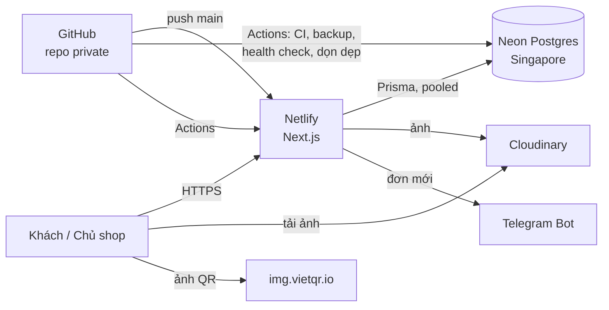
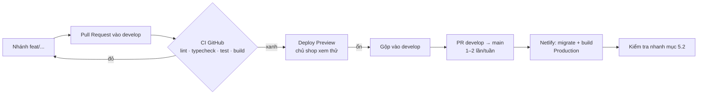

# 09 — DEPLOYMENT: Hạ tầng, triển khai, sao lưu, vận hành

> Dựa trên `00-MASTER-PLAN.md` v0.2, `01-TECH-STANDARDS.md` v1.0, `08-SECURITY-SEO.md` v1.0 · Phiên bản: v1.1 · 2026-10-05
>
> Mục tiêu: chạy thật với chi phí **gần 0đ/tháng** (chỉ trả tiền tên miền), dễ vận hành bởi một người.

---

## 1. Sơ đồ hạ tầng

---

## 2. Dịch vụ và gói miễn phí

| Dịch vụ | Gói | Giới hạn chính cần nhớ | Khi chạm giới hạn |
|---|---|---|---|
| **Netlify** | Free | **300 credits/tháng**. Mỗi lần deploy production tốn 15 credits; băng thông 20 credits/GB; compute 10 credits/GB-giờ; 2 credits/10.000 request | Website **tạm dừng** đến tháng sau, không tính phí phát sinh |
| **Neon** | Free | 1 GB lưu trữ/project; 100 CU-giờ compute/project/tháng; tự tắt sau 5 phút không dùng; khôi phục trong 6 giờ gần nhất | Không ghi thêm được dữ liệu / compute tạm ngừng |
| **Cloudinary** | Free | 25 credits/tháng (1 credit ≈ 1 GB lưu trữ, hoặc 1 GB băng thông, hoặc 1.000 lần biến đổi ảnh) | Ảnh ngừng phục vụ / biến đổi đến tháng sau |
| **GitHub** | Free (private repo) | Số phút Actions miễn phí mỗi tháng có giới hạn (đủ cho CI + tác vụ định kỳ của dự án nhỏ) | Actions dừng đến tháng sau |
| **Telegram Bot** | Miễn phí | — | — |
| **Tên miền** | Trả phí theo năm | — | — |

> Bảng giá và giới hạn của các dịch vụ thay đổi thường xuyên (Netlify đã điều chỉnh tỉ lệ credits vào tháng 4/2026). **Kiểm tra lại khi đăng ký** và ghi ngày kiểm tra vào mục 10.

### 2.1 Ngân sách credits Netlify (ước tính mỗi tháng)

| Hạng mục | Ước tính | Credits |
|---|---|---|
| Deploy production | 8 lần | 120 |
| Băng thông HTML/JS/CSS (ảnh nằm ở Cloudinary) | ~3 GB | 60 |
| Request | ~150.000 | 30 |
| Compute (server render, server action) | ~4 GB-giờ | 40 |
| **Dự phòng** | | **50** |
| **Tổng** | | **300** |

**Quy tắc để không vượt credits**
1. **Gộp thay đổi rồi mới deploy production**: việc hằng ngày gộp vào `develop`; gộp `develop` → `main` theo đợt (khoảng 1–2 lần/tuần). Tối đa **10 lần deploy production/tháng**.
2. Chỉ build `main` (production), `develop` (branch deploy) và Pull Request. Theo bảng credits hiện tại chỉ deploy production bị tính 15 credits; **kiểm tra lại** trên trang Usage sau tuần đầu.
3. Bỏ qua build khi chỉ sửa tài liệu: cấu hình lệnh `ignore` để không build nếu commit chỉ đổi `docs/` hoặc `*.md`.
4. Ảnh luôn phục vụ từ Cloudinary, **không** đặt ảnh lớn trong `public/`.
5. Dùng cache trang (`08` mục 15) để giảm compute.
6. Theo dõi credits trên bảng điều khiển Netlify **mỗi tuần** trong tháng đầu.

### 2.2 Phương án dự phòng
Nếu credits liên tục chạm 80% trước cuối tháng:
- **A.** Nâng lên gói trả phí thấp nhất của Netlify (website không bị tạm dừng).
- **B.** Chuyển sang Cloudflare Workers dùng adapter OpenNext cho Next.js (gói miễn phí giới hạn theo số request/ngày, cho phép dùng thương mại). Cần kiểm tra mức hỗ trợ tính năng Next.js tại thời điểm chuyển.

Nhờ kiến trúc ở `01`, đổi nhà cung cấp hosting chỉ ảnh hưởng cấu hình deploy, không phải sửa code nghiệp vụ.

---

## 3. Môi trường

| Môi trường | Code | Database | URL | Dữ liệu |
|---|---|---|---|---|
| **Local** | máy chủ shop | Neon branch `dev` | `localhost:3000` | Seed mẫu |
| **Preview** | mỗi Pull Request và nhánh `develop` | Neon branch `preview` | URL deploy preview / branch deploy của Netlify | Seed mẫu |
| **Production** | nhánh `main` | Neon branch `main` | tên miền chính | Dữ liệu thật |

- Branch của Neon tách dữ liệu nhưng dùng chung project, không tốn thêm tiền.
- Biến môi trường trên Netlify đặt **theo ngữ cảnh** (Production / Deploy Previews) để preview không bao giờ ghi vào database thật.
- Telegram ở môi trường preview gửi vào chat thử nghiệm riêng, hoặc tắt (biến `TELEGRAM_ENABLED=false`).

---

## 4. Thiết lập lần đầu (chủ shop làm theo, AI hỗ trợ từng bước)

### 4.1 Tài khoản
- [ ] GitHub: tạo repository **private** `lamora-flower`.
- [ ] Neon: tạo project `lamora-flower`, region **Singapore (AWS ap-southeast-1)**. Tạo branch `dev` và `preview`.
- [ ] Cloudinary: tạo tài khoản, tạo thư mục `lamora/products`, `lamora/categories`, `lamora/banners`.
- [ ] Telegram: tạo bot theo `07` mục 4.1.
- [ ] Netlify: đăng nhập bằng GitHub, **chưa** kết nối repo cho tới khi xong bước A4 (`04` mục 14).

### 4.2 Kết nối Netlify
- [ ] Import repo từ GitHub, nhánh production `main`.
- [ ] Netlify tự nhận Next.js và dùng adapter tương ứng; kiểm tra phiên bản Next.js được hỗ trợ.
- [ ] Lệnh build:
  - Production: `pnpm prisma migrate deploy && pnpm build`
  - Deploy Preview: `pnpm prisma migrate deploy && pnpm build` (trỏ tới branch `preview`)
- [ ] Phiên bản Node lấy từ `.nvmrc`.
- [ ] Nhập biến môi trường (`01` mục 14 + `IP_HASH_SALT`, `CRON_SECRET`, `TELEGRAM_ENABLED`).
- [ ] Cấu hình bỏ qua build khi chỉ sửa tài liệu (mục 2.1, quy tắc 3).

### 4.3 Tên miền
- [ ] Mua tên miền (gợi ý `lamoraflower.vn` hoặc `lamoraflower.com`) tại nhà đăng ký uy tín. `.vn` cần khai báo thông tin chủ thể theo quy định.
- [ ] Trỏ DNS về Netlify theo hướng dẫn của Netlify (bản ghi `A`/`ALIAS` cho tên miền gốc, `CNAME` cho `www`).
- [ ] Netlify tự cấp HTTPS (Let's Encrypt). Bật “Force HTTPS”.
- [ ] Chọn một dạng chính (có hoặc không `www`), dạng còn lại chuyển hướng 301.
- [ ] Cập nhật `NEXT_PUBLIC_SITE_URL` và deploy lại.

---

## 5. Quy trình phát hành

### 5.1 Trước khi gộp `develop` vào `main`
- [ ] CI xanh.
- [ ] Đã xem deploy preview trên **điện thoại** và máy tính.
- [ ] Nếu có migration: migration tương thích ngược (`01` mục 12.4).
- [ ] Có thay đổi lớn (luồng đặt hàng, thanh toán): chạy E2E Playwright.

### 5.2 Kiểm tra nhanh sau mỗi lần deploy production (5 phút)
- [ ] Trang chủ, một trang danh sách, một trang chi tiết mở được.
- [ ] Thêm giỏ → trang thanh toán hiện phí ship đúng.
- [ ] Đăng nhập admin được, danh sách đơn hiện đúng.
- [ ] `/api/health` trả `ok`.

### 5.3 Quay lại bản trước (rollback)
- Code: trên Netlify, mở danh sách deploy, chọn bản trước → **Publish deploy**. Website trở lại ngay.
- Database: migration luôn tương thích ngược nên code cũ vẫn chạy với schema mới. Nếu dữ liệu bị hỏng: khôi phục theo mục 6.3.

---

## 6. Sao lưu và khôi phục

Gói Free của Neon chỉ cho khôi phục trong **6 giờ gần nhất**, nên cần sao lưu riêng.

### 6.1 Sao lưu tự động hằng ngày
- GitHub Actions `backup.yml`, chạy **02:00 giờ Việt Nam** mỗi ngày.
- Các bước: `pg_dump` (dùng `DIRECT_URL` của branch `main`; phiên bản `pg_dump` khớp phiên bản Postgres của Neon) → nén → **mã hóa bằng GPG** với `BACKUP_PASSPHRASE` → lưu thành artifact của workflow, giữ **30 ngày**.
- Chủ nhật hằng tuần: chủ shop tải một bản về lưu ở Google Drive cá nhân (giữ lâu dài).
- Workflow lỗi → GitHub gửi email thông báo.

### 6.2 Ảnh
Ảnh nằm trên Cloudinary. Mỗi tháng xuất danh sách `publicId` từ database (đã có trong bản sao lưu). Giữ **ảnh gốc** trong thư mục máy tính/Google Drive của chủ shop.

### 6.3 Khôi phục
1. Sự cố trong vòng 6 giờ: dùng tính năng khôi phục theo thời điểm của Neon (tạo branch từ thời điểm trước sự cố, kiểm tra, rồi đổi sang).
2. Cũ hơn: tải artifact sao lưu → giải mã GPG → `pg_restore` vào một branch mới của Neon → kiểm tra → trỏ `DATABASE_URL` sang.
3. **Diễn tập khôi phục** một lần trước khi ra mắt và mỗi quý một lần (`10` mục 8).

---

## 7. Tác vụ định kỳ

Dùng GitHub Actions `schedule` gọi tới route nội bộ có bảo vệ bằng header `Authorization: Bearer <CRON_SECRET>`.

| Tác vụ | Lịch (giờ VN) | Cách làm | Ưu tiên |
|---|---|---|---|
| Sao lưu database | 02:00 hằng ngày | `backup.yml` (mục 6.1) | P0 |
| Kiểm tra website sống | Mỗi giờ | `health.yml` gọi `/api/health`; lỗi 2 lần liên tiếp → gửi Telegram | P0 |
| Dọn `RateLimitHit` cũ, xóa `ipHash` > 90 ngày | 03:00 hằng ngày | gọi `POST /api/cron/cleanup` | P0 |
| Nhắc đơn chờ xác nhận | 08:00 hằng ngày | gọi `POST /api/cron/pending-reminder` | P1 |

- Lịch của GitHub Actions dùng giờ UTC (02:00 giờ VN = 19:00 UTC hôm trước) và có thể chạy trễ vài phút.
- Health check mỗi giờ sẽ đánh thức database Neon; mức này nằm trong hạn mức compute miễn phí. Không đặt dày hơn.
- Thêm route `/api/cron/*` vào `04` mục 12.

---

## 8. Giám sát và xử lý sự cố

| Theo dõi | Ở đâu | Tần suất |
|---|---|---|
| Credits Netlify | Bảng điều khiển Netlify → Usage | Hằng tuần |
| Dung lượng và compute Neon | Bảng điều khiển Neon | Hằng tháng |
| Credits Cloudinary | Bảng điều khiển Cloudinary | Hằng tháng |
| Lỗi server | Netlify → Logs (Functions) | Khi có báo lỗi |
| Website sống | Telegram từ `health.yml` | Tự động |
| Tốc độ trang | PageSpeed Insights | Hằng tháng |
| Lượt truy cập, chuyển đổi | Google Analytics | Hằng tuần |
| Lập chỉ mục | Google Search Console | Hằng tháng |

P1: thêm dịch vụ theo dõi lỗi có gói miễn phí (ví dụ Sentry) để nhận báo lỗi chi tiết. Kiểm tra điều khoản gói miễn phí khi thêm.

### 8.1 Sổ tay sự cố
| Hiện tượng | Kiểm tra | Xử lý |
|---|---|---|
| Website báo tạm dừng | Credits Netlify | Nâng gói hoặc chờ tháng mới; xem phương án 2.2 |
| Trang tải chậm vài giây lần đầu | Neon vừa thức dậy sau khi tự tắt | Bình thường ở gói Free |
| Ảnh không hiện | Credits Cloudinary | Nâng gói hoặc giảm biến đổi ảnh |
| Không nhận tin Telegram | Token, chat ID; log `notifyNewOrder` | Kiểm tra lại biến môi trường |
| Đặt hàng báo lỗi chung | Log Netlify, `/api/health` | Quay lại bản deploy trước (mục 5.3) |
| Lộ khóa bí mật | — | Đổi khóa ngay trên dịch vụ tương ứng, cập nhật Netlify, deploy lại |

---

## 9. File cấu hình cần tạo

| File | Nội dung |
|---|---|
| `netlify.toml` | Lệnh build theo ngữ cảnh, lệnh `ignore` cho thay đổi chỉ ở tài liệu, header bảo mật (nếu không đặt trong `next.config`) |
| `.github/workflows/ci.yml` | lint, typecheck, test, build, `pnpm audit` |
| `.github/workflows/e2e.yml` | Playwright, chạy thủ công hoặc khi PR có nhãn `e2e` |
| `.github/workflows/backup.yml` | Mục 6.1 |
| `.github/workflows/health.yml` | Mục 7 |
| `.github/workflows/cron.yml` | Dọn dẹp, nhắc đơn |
| `.github/dependabot.yml` | Cập nhật phụ thuộc hằng tháng, gộp nhóm, nhắm vào `develop` |
| `.nvmrc` | Phiên bản Node LTS |

**Biến bí mật trên GitHub Actions**: `PROD_DIRECT_URL`, `BACKUP_PASSPHRASE`, `CRON_SECRET`, `SITE_URL`, `TELEGRAM_BOT_TOKEN`, `TELEGRAM_CHAT_ID`.

---

## 10. Nhật ký kiểm tra gói dịch vụ

| Ngày | Dịch vụ | Giới hạn ghi nhận | Người kiểm tra |
|---|---|---|---|
| 2026-10-05 | Netlify Free | 300 credits/tháng; deploy production 15 credits; băng thông 20 credits/GB | Lập kế hoạch |
| 2026-10-05 | Neon Free | 1 GB/project; 100 CU-giờ/project/tháng; tự tắt sau 5 phút | Lập kế hoạch |
| 2026-10-05 | Cloudinary Free | 25 credits/tháng | Lập kế hoạch |

---

## 11. Cần xác nhận

1. Bạn muốn tên miền `.vn` hay `.com`? `.vn` tạo cảm giác thương hiệu Việt và giúp công cụ tìm kiếm nhận biết website hướng tới khách Việt Nam; `.com` dễ đăng ký hơn.
2. Bạn có tài khoản Google Drive để lưu bản sao lưu hằng tuần không?

---

## Nhật ký thay đổi

| Phiên bản | Ngày | Thay đổi |
|---|---|---|
| v1.1 | 2026-10-05 | Thêm nhánh `develop` để gộp deploy production theo đợt |
| v1.0 | 2026-10-05 | Bản đầu tiên |
